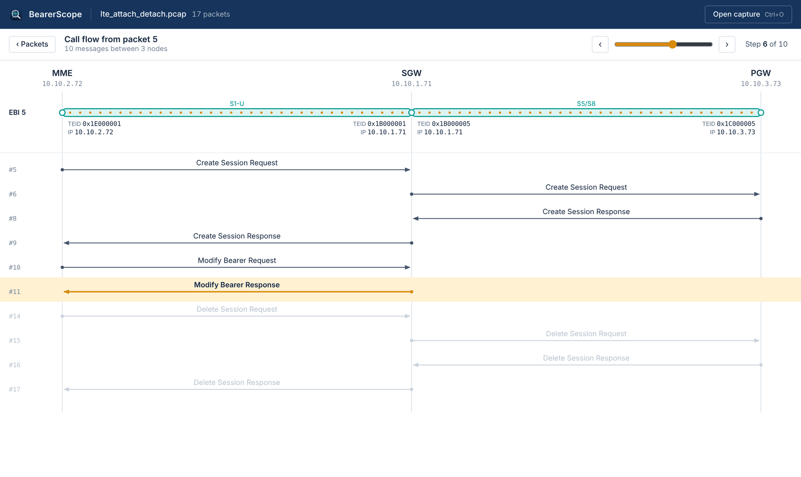
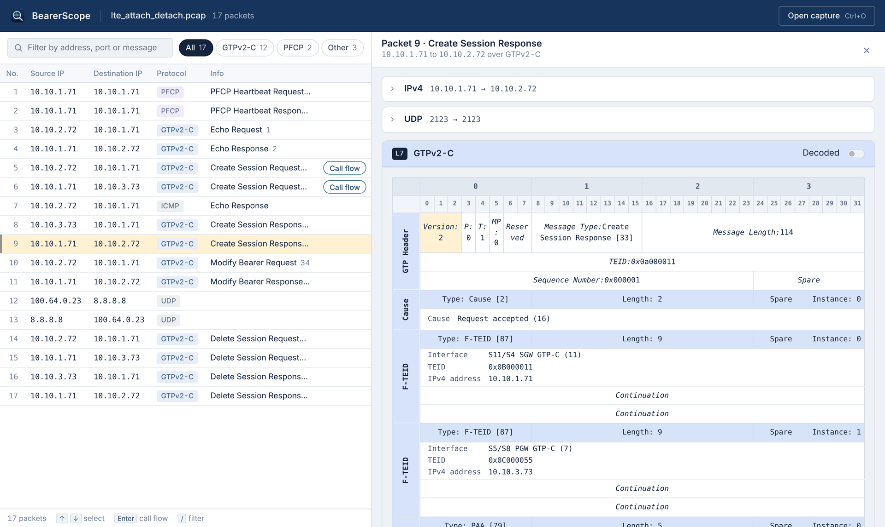
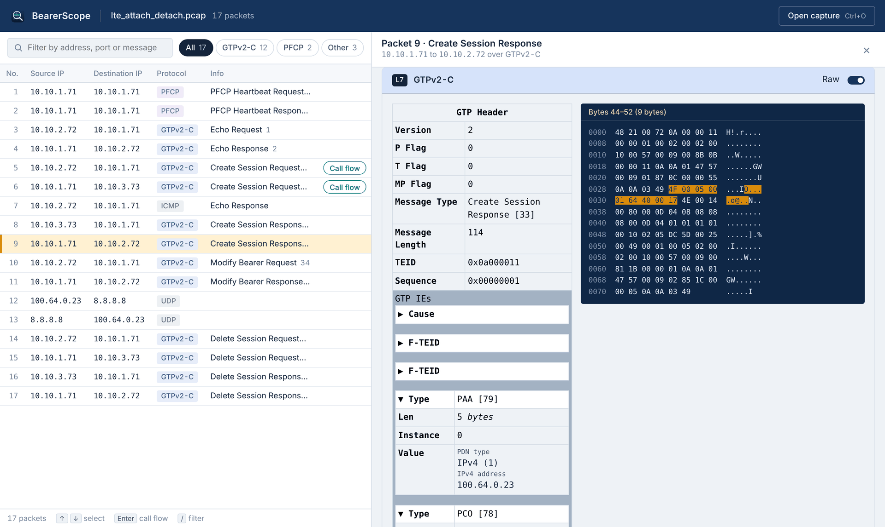

<p align="center">
  
</p>

<h1 align="center">BearerScope</h1>

<p align="center">
  A desktop analyzer for LTE / 5G core signaling captures.<br>
  Open a pcap, follow a session across MME, SGW and PGW, and watch its bearers and GTP-U tunnels come up and go down message by message.
</p>

<p align="center">
  
</p>

General-purpose tools show you GTPv2-C and PFCP messages one packet at a time. BearerScope reads them the way a core network engineer does: as a **session**. Pick any Create Session Request and it rebuilds the ladder diagram for that UE, then draws the S1-U and S5/S8 tunnels, with their TEIDs and endpoint addresses, as they exist after each step.

## Features

- **Session call flow.** A ladder diagram across MME, SGW and PGW, with node roles inferred from the traffic. Step through it with the slider or the arrow keys.
- **Bearer and tunnel state.** For every EPS bearer, the S1-U and S5/S8 GTP-U tunnels are drawn between their endpoints with TEID and IP. Tunnels are marked as being set up, up, or being released.
- **Packet inspector.** IP, UDP/TCP and the GTPv2-C or PFCP message, in wire order. The message has two views:
  - **Decoded:** the 32-bit field grid from the 3GPP specs, so each IE sits where it does on the wire.
  - **Raw:** collapsible IEs next to a hex dump. Hovering an IE highlights its bytes.
- **IE decoding** for the IEs you actually look at:
  - **GTPv2-C (TS 29.274):** IMSI, MSISDN, MEI, APN, AMBR, Bearer QoS, F-TEID (with interface names), PAA, PCO/APCO/ePCO (DNS, P-CSCF, MTU, IPCP), Cause (with flags and offending IE), Indication flags, ULI (TAI/ECGI), Serving Network, UE Time Zone, Charging ID and Characteristics, ARP, FQ-CSID, Bearer TFT and more
  - **PFCP (TS 29.244):** Cause, F-SEID, F-TEID (including CHOOSE), Node ID, UE IP Address, PDI interfaces, Apply Action, Outer Header Creation/Removal, Gate Status, MBR/GBR, Recovery Time Stamp, PDR/FAR/QER/URR IDs and more
- **Fast to drive from the keyboard:**

  | Key | Action |
  |---|---|
  | <kbd>Ctrl/⌘ O</kbd> | open a capture |
  | <kbd>/</kbd> | filter by address, port or message |
  | <kbd>↑</kbd> <kbd>↓</kbd> | move through packets |
  | <kbd>Enter</kbd> | open the call flow |
  | <kbd>←</kbd> <kbd>→</kbd> | step through the call flow |
  | <kbd>Esc</kbd> | close |

  You can also drag and drop a capture onto the window.
- **Local only.** Captures are parsed on your machine and never uploaded. pcap and pcapng are supported, with Ethernet and Linux cooked (SLL2) link types.

| Packet list and decoded message | Raw view with IE highlight |
|---|---|
|  |  |

## Install

Prebuilt installers for macOS (Apple Silicon and Intel) and Windows are attached to [GitHub Releases](https://github.com/Git-ijhwang/BearerScope/releases).

The macOS build is not signed yet. On first launch, right-click the app and choose **Open**.

## Build from source

Requirements:
- Rust 1.85 or newer (edition 2024)
- Node.js 20 or newer
- The [Tauri v2 prerequisites](https://v2.tauri.app/start/prerequisites/) for your OS

```bash
git clone https://github.com/Git-ijhwang/BearerScope
cd BearerScope/ui
npm install

npm run tauri dev      # run with hot reload
npm run tauri build    # installer in ../target/release/bundle/
```

If rustc crashes with `SIGSEGV` during a release build, give it a larger stack:

```bash
RUST_MIN_STACK=16777216 npm run tauri build
```

Want something to open? `tests/fixtures/lte_attach_detach.pcap` is a synthetic attach and detach (S11 + S5) with test identities. The screenshots above were taken from it.

## Command line

The same parser ships as a small CLI that prints JSON. This is handy for scripting, diffing, or checking what the UI is fed.

```bash
cargo run -p bearerscope-cli -- --pretty summary  capture.pcap      # one line per packet
cargo run -p bearerscope-cli -- --pretty packet   capture.pcap 9    # full decode of packet 9
cargo run -p bearerscope-cli -- --pretty callflow capture.pcap 5    # session + bearer snapshots from packet 5
```

Packet numbers start at 1, as in Wireshark.

## How it is built

```
crates/
  bearerscope-core/   parsing and session model (pure Rust, no I/O beyond reading the capture)
    capture.rs        pcap / pcapng reader (pcap-file)
    ip/, l4/          IPv4, IPv6, UDP, TCP, ICMP
    gtp/              GTPv2-C header, IEs, call flow and bearer state
    pfcp/             PFCP header and IEs
  bearerscope-cli/    clap front end over the core
ui/
  src/                React (Vite) interface
  src-tauri/          Tauri v2 shell: three commands over the core
tests/fixtures/       synthetic captures and golden JSON
```

- **No libpcap.** The core is synchronous and has no libpcap dependency, so it builds the same way on macOS, Windows and Linux.
- **Three commands.** The desktop app exposes exactly three Tauri commands (`parse_summary`, `packet_detail`, `call_flow`). Each runs the core on a blocking thread and returns the same JSON the CLI prints.

## Tests

```bash
cargo test
```

Golden tests run the parser over the synthetic captures in `tests/fixtures/` and compare the summary and call flow output against stored JSON. Every IMSI, MSISDN and address in those captures is a test value. Please don't add real network captures to the repository, because they contain subscriber identities.

## Roadmap

- Start a call flow from any message of a session, not only Create Session Request
- Dedicated bearers: Create/Update/Delete Bearer procedures in the tunnel view
- PFCP sessions: follow N4/Sxb rules (PDR, FAR, QER) alongside the GTP-C flow
- 5G SA: NGAP and HTTP/2 SBI signaling
- Export a call flow as SVG or PNG

## License

Licensed under either of MIT or Apache-2.0, at your option.
